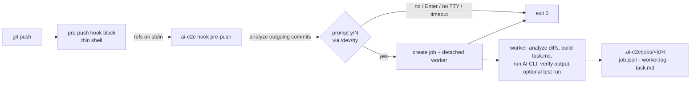

# ai-e2e

Optional, local-first tool that offers to generate Playwright E2E tests for your outgoing changes when you `git push`.

```
$ git push
ai-e2e: 2 outgoing commit(s), 5 changed file(s).
Would you like to generate E2E tests for these changes using AI? [y/N] y
ai-e2e: started background job 20261012-151203-a1b2c3. Check progress with `ai-e2e status` and `ai-e2e logs`.
...push continues immediately...
```

**It is never a push gate.** Declining, pressing Enter, having no terminal, a missing AI CLI, a broken config, a failed
worker launch, provider errors and failing generated tests all leave the push unaffected. Your own hook logic still runs
and keeps its own exit semantics.

## How it works



| Module | Responsibility |
| --- | --- |
| `src/cli.ts`, `src/commands.ts` | Entry point, argument parsing (`node:util` `parseArgs`, strict), command handlers |
| `src/config.ts` | `.ai-e2e.json` schema validation, defaults, `config get/set` |
| `src/refs.ts` | Parses pre-push stdin (`<local ref> <local sha> <remote ref> <remote sha>`) |
| `src/changes.ts` | Resolves commit ranges per ref (update, new branch, force push, deletion), changed files, bounded and redacted diffs |
| `src/exclusions.ts`, `src/glob.ts`, `src/redact.ts` | Sensitive/generated file exclusion and secret redaction |
| `src/prompt.ts` | y/N prompt on the controlling terminal (stdin carries the refs) |
| `src/hook.ts` | Hook flow; every path resolves, errors become one-line messages |
| `src/hookInstall.ts` | Inserts/removes a marked block in the existing hook, husky/hook-manager detection, `.gitignore` |
| `src/jobs.ts` | Job records, atomic writes, fingerprint locks, stale/crashed worker detection, pruning |
| `src/launcher.ts` | Detached worker spawn with log redirection; duplicate handling |
| `src/worker.ts` | Generation pipeline and post-run safety checks |
| `src/playwright.ts`, `src/taskPrompt.ts` | Playwright setup detection (without executing the config), structured task for the agent |
| `src/providers/*` | `AiProvider` interface, Copilot CLI and Claude Code implementations, availability detection |

No runtime dependencies; dev dependencies are `typescript` and `@types/node` only.

## Prerequisites

- Node.js ≥ 20.10 (tested on 20.20 and 23.4), Git ≥ 2.24 (uses `--end-of-options`).
- A repository with Playwright (`playwright.config.*` or a `@playwright/test` dependency).
- At least one AI CLI, authenticated: GitHub Copilot CLI (`copilot`) or Claude Code (`claude`).

## Install

Install the CLI from GitHub:

```sh
npm install --global https://github.com/Raj-Pratik/e2e-ai/archive/refs/heads/main.tar.gz
```

The CLI requires Node.js 20.10 or newer. Authenticate at least one supported
provider before generating tests:

```sh
copilot login
# or: claude auth login
```

## Build from source

```sh
npm install
npm run build      # emits dist/
npm test           # build + 91 unit/integration tests (no AI access needed)
```

## Initialise a repository

From anywhere inside the target repository, after installing the CLI:

```sh
ai-e2e init
```

`init`:

1. Creates `.ai-e2e.json` if missing (commit it to share settings).
2. Adds the state directory (`/.ai-e2e/`) to `.gitignore` unless already ignored; existing entries are untouched.
3. Inserts a marked block (`# >>> ai-e2e >>>` … `# <<< ai-e2e <<<`) into the `pre-push` hook:
   - honours `core.hooksPath` (e.g. this repository's tracked `.git-hooks/`);
   - with husky v8/v9 (`core.hooksPath` = `.husky` or `.husky/_`) it edits `.husky/pre-push`;
   - an existing hook is backed up to `.ai-e2e/backups/` and kept intact — the block is placed after the shebang and
     re-feeds the ref list to the rest of the script (`exec 0< file`), so your hook still reads stdin and can still
     reject the push;
   - it refuses to modify hooks owned by managers that regenerate them (lefthook, pre-commit, simple-git-hooks,
     husky v4) or non-shell hooks, and prints integration instructions instead (`--force` overrides).
4. Reports Playwright detection and provider availability.

The hook first resolves the installed `ai-e2e` command from `PATH`, so the
same hook can be shared by every developer. If the command is unavailable, it
falls back to the CLI path used during installation and prints one line before
skipping.

### Hook managers

For lefthook / pre-commit / simple-git-hooks, call the CLI from your pre-push command and forward stdin:

```yaml
# lefthook.yml
pre-push:
  commands:
    ai-e2e:
      use_stdin: true
      run: node ai-e2e/dist/src/cli.js hook pre-push {1} {2} || true
```

## Commands

```sh
ai-e2e init [--no-hook] [--force]
ai-e2e generate [--base <rev>] [--head <rev>] [--provider <id>] [--foreground] [--force]
ai-e2e status [<job-id>] [--json] [--limit <n>]
ai-e2e logs [<job-id>] [--tail <n>]
ai-e2e config [show | get <key> | set <key> <value> | validate | path]
ai-e2e providers [--json]
ai-e2e playwright-init [--yes]
ai-e2e uninstall
ai-e2e help
```

Examples:

```sh
ai-e2e generate                         # upstream..HEAD in the background
ai-e2e generate --base origin/develop --foreground
ai-e2e status && ai-e2e logs --tail 50
ai-e2e config set provider claude
ai-e2e config set mcp.playwright.enabled true
AI_E2E_SKIP=1 git push                  # bypass entirely
AI_E2E_ASSUME=yes git push              # accept without a prompt (explicit opt-in)
```

Exit codes: `0` success, `1` failure, `2` usage error. `hook` always exits `0`.

## Configuration (`.ai-e2e.json`)

Unknown keys and wrong types are rejected with the offending path. See [examples/ai-e2e.example.json](examples/ai-e2e.example.json).

| Key | Default | Meaning |
| --- | --- | --- |
| `enabled` | `true` | Master switch for the hook |
| `provider` | `"copilot"` | `copilot` or `claude` |
| `providers.<id>.command` | provider default | CLI path/name |
| `providers.<id>.model` | `null` | Passed as `--model` |
| `providers.<id>.extraArgs` | `[]` | Extra argv (array, never a shell string). Permission-bypassing flags are rejected unless `allowUnsafeArgs: true` |
| `providers.<id>.allowedShellCommands` | `[]` | Shell access for the agent; empty = none |
| `providers.claude.maxTurns` | `40` | `--max-turns` |
| `prompt.timeoutSeconds` | `60` | Unanswered prompt = decline |
| `generation.timeoutSeconds` | `900` | Provider timeout (process group is killed) |
| `generation.maxOutputBytes` | `1 MiB` | Captured provider output (tail kept) |
| `generation.outputDir` | test dir | Where new tests go |
| `generation.allowModifyExistingTests` | `false` | If false, agent edits to existing tests are reverted and saved as patches |
| `playwright.configPath` / `testDir` | auto | Override detection |
| `playwright.runGeneratedTests` | `false` | Run only newly generated specs after generation |
| `playwright.testCommand` | local Playwright CLI | argv array; generated spec paths are appended |
| `mcp.playwright.enabled` | `false` | Offer Playwright MCP to the agent |
| `mcp.playwright.command` / `args` | `npx @playwright/mcp@latest` | MCP server command |
| `mcp.playwright.baseUrl` | `null` | Only URL the agent is told it may visit |
| `context.exclude` | `[]` | Extra glob exclusions |
| `context.excludeGenerated` | `true` | Skip lockfiles, build output, binaries |
| `context.maxFiles` / `maxCommits` | `60` / `50` | Analysis limits |
| `context.maxDiffBytesPerFile` / `maxTotalDiffBytes` | `20000` / `120000` | Diff limits |
| `context.maxPromptBytes` / `maxRelatedTests` | `200000` / `3` | Task-file limits |
| `jobs.duplicate` | `"skip"` | `skip`: don't rerun an active or succeeded job for the same change set; `allow` |
| `jobs.stateDir` | `".ai-e2e"` | Jobs, logs, locks, backups |
| `jobs.keep` | `30` | Finished jobs retained |

## Providers

Each provider implements `AiProvider` (`src/providers/types.ts`): it only builds an argv. Detection (`--version`),
timeouts, output limits, logging and redaction are shared. The prompt is written to `.ai-e2e/jobs/<id>/task.md`; the
CLI receives a one-line instruction pointing at it, which keeps argv small on every OS.

### GitHub Copilot CLI

Verified against the installed `copilot` 1.0.94 (`copilot --help`, `copilot help permissions`):

```
copilot -p "<instruction>" --silent --no-ask-user --allow-all-tools --deny-tool=shell \
  --deny-tool=write(.env) --deny-tool=write(.git) [--secret-env-vars=...] [--model m] [--additional-mcp-config <json>]
```

`--allow-all-tools` is documented as required for `-p`; deny rules take precedence over it, so shell is denied entirely
by default. Setting `allowedShellCommands` switches to a deny-list of state-changing commands (git push/commit/reset/…,
rm, curl, npm…). Names (not values) of secret-looking environment variables are passed to `--secret-env-vars`.
Authenticate once with `copilot login`.

### Claude Code

Claude Code is **not installed on the machine this was built on**; the invocation follows the official CLI reference
(<https://code.claude.com/docs/en/cli-reference>) and is covered by argv tests only:

```
claude -p "<instruction>" --output-format text --permission-mode acceptEdits --no-session-persistence \
  --max-turns 40 [--model m] [--mcp-config <json> --strict-mcp-config --allowedTools mcp__playwright] \
  --disallowedTools Bash --disallowedTools WebFetch --disallowedTools WebSearch
```

Verify once with a real run (`ai-e2e config set provider claude && ai-e2e generate --foreground`). Authenticate with
`claude auth login`.

### Adding a provider

1. Create `src/providers/<id>.ts` exporting an `AiProvider` (`id`, `displayName`, `defaultCommand`, `supportsMcp`,
   `unsafeArgs`, `verification`, `buildInvocation`). Use only flags you have verified for non-interactive use.
2. Register it in `src/providers/index.ts`.
3. Add argv tests in `test/providers.test.ts`.

Settings for the new id work automatically under `providers.<id>`.

## Playwright MCP (optional)

Disabled by default. When enabled, and the provider supports MCP, and `mcp.playwright.command` resolves on `PATH`, the
server is passed to the agent for this run only (`--additional-mcp-config` for Copilot, `--mcp-config
--strict-mcp-config` for Claude). Otherwise the job logs why and falls back to source analysis. ai-e2e never starts your
application; set `baseUrl` to an app you are already running locally. The task forbids destructive UI actions and
production systems, but this is an instruction to the agent, not an enforcement boundary.

## Jobs, logs and output

```
.ai-e2e/
  jobs/<id>/job.json       status, timestamps, pid, exit code, generated files, warnings, test result
  jobs/<id>/worker.log     timestamped, redacted worker + provider output
  jobs/<id>/refs.txt       pushed refs
  jobs/<id>/task.md        exact task sent to the agent (review what left your machine)
  jobs/<id>/proposed/      patches for existing files the agent tried to change
  locks/<fingerprint>.lock duplicate protection
  backups/                 previous hook versions
```

Statuses: `queued`, `running`, `succeeded`, `failed`, `skipped`, `crashed` (worker died: detected via PID liveness, or
no start within 2 minutes). Generated files are new, untracked and never staged, committed or pushed. After the run the
worker:

- restores any pre-existing test/helper file the agent modified or deleted (unless `allowModifyExistingTests`) and
  stores the agent's version plus a patch under `proposed/`;
- warns if files outside the test directories changed or the Git index changed (it does not revert those, to avoid
  clobbering edits you made concurrently);
- optionally runs only the new specs; failures are recorded, not escalated.

## Security and privacy

- **Code leaves your machine** when you answer `y`: outgoing diffs, commit subjects, changed paths, the Playwright config
  and a few related tests/helpers are sent to the selected provider. Review `task.md` to see exactly what was sent.
- Sensitive files are never included, regardless of config: `.env*`, keys/certificates, `id_rsa*`, `.npmrc`, `.netrc`,
  `credentials*`, `*secret*`, Terraform state/vars, kubeconfigs, Playwright auth/storage state (`**/.auth/**`,
  `storageState*.json`), `.aws`/`.ssh`/`.gnupg`.
- Diffs, included files and all log lines pass through secret redaction (private keys, GitHub/AWS/Slack/Google/Stripe/
  Anthropic tokens, JWTs, bearer tokens, `password=`-style assignments, credentials in URLs). Redaction is heuristic.
- No shell interpolation anywhere: every process is spawned with an argv array; hook paths are single-quoted; Git
  revisions from the CLI pass through `--end-of-options`; SHAs from stdin are validated; job ids are validated
  (no path traversal); config keys like `__proto__` are rejected.
- The agent is denied shell access by default, and permission-bypassing provider flags are refused unless explicitly
  allowed. Hook-specific `GIT_*` variables are stripped from the worker; `AI_E2E_WORKER=1` prevents recursive prompts.
- Nothing is committed, staged, amended or pushed by ai-e2e.

## Platform notes

- **macOS / Linux**: the worker is spawned `detached` (new session via `setsid`), so it survives the hook exiting and
  the terminal closing. It does not survive logout on systems that kill user sessions (e.g. systemd
  `KillUserProcesses=yes`), sleep pauses it, and reboot kills it — the job is then reported as `crashed`.
- **Windows**: best effort, not tested. Hooks run in Git Bash; the prompt opens `CONIN$` (may be unavailable, which
  counts as decline — use `AI_E2E_ASSUME=yes` or `ai-e2e generate`). Detached workers run in a hidden console and may
  stop at logoff. `.cmd` shims (e.g. `npx.cmd`) cannot be spawned without a shell; configure `testCommand`/MCP commands
  with real executables (`node path/to/cli.js`). Process-group kill on timeout is POSIX-only.
- PID reuse could make a long-dead job look alive until the PID is recycled again; `status` reconciles on every read.
- GUI Git clients may run hooks without `node` on `PATH`; the block then skips silently. Without a TTY the prompt is
  never shown (decline).
- Only committed changes are analyzed; uncommitted working-tree changes are intentionally ignored.

## Troubleshooting

| Symptom | Check |
| --- | --- |
| No prompt during push | `AI_E2E_SKIP` set? `enabled: false`? No TTY (IDE push)? Hook block present (`grep ai-e2e .git/hooks/pre-push` or your `core.hooksPath`)? CLI built? |
| `provider unavailable` | `ai-e2e providers`; `providers.<id>.command`; log in with `copilot login` / `claude auth login` |
| Job `crashed` | Worker killed (reboot, logout, OOM). `ai-e2e logs <id>`, then `ai-e2e generate --force` |
| `duplicate` | Same change set already generated; `ai-e2e generate --force` |
| `skipped: No Playwright setup` | `ai-e2e playwright-init` |
| Invalid config | `ai-e2e config validate` |

## Uninstall

```sh
ai-e2e uninstall          # removes only the marked block; deletes the hook file if ai-e2e created it
rm .ai-e2e.json           # optional
rm -rf .ai-e2e            # optional: jobs, logs, backups
```

If the hook lives in a tracked directory (e.g. `.git-hooks/`), commit the change deliberately.
